# Manual de usuario - Plataforma LABM

Liga Antioqueña de Balonmano · Versión 1.5 · 19 de octubre de 2026

Esta guía está dirigida a las personas que crean, revisan y publican contenido. La [cartilla visual en PDF](cartilla-manual-usuario-labm.pdf) complementa este documento con una explicación breve por sección.

Las capturas reales del panel administrativo del proyecto se realizaron el 10 de octubre de 2026. Las imágenes de campos personalizados corresponden a una captura real del panel nativo **Custom Fields** (`Name`, `Value`, `Delete`, `Update` y `Add Custom Field`). No se usan composiciones ni ilustraciones para representar controles. Algunos controles están en inglés porque ese es el idioma del administrador capturado; se indican las equivalencias en español. La disponibilidad de los menús depende de los permisos de cada cuenta.

## Índice

1. [Ingresar al administrador](#1-ingresar-al-administrador)
2. [Encontrar la sección correcta](#2-encontrar-la-sección-correcta)
3. [Crear, revisar, publicar y actualizar](#3-crear-revisar-publicar-y-actualizar)
4. [Actualidad: noticias y eventos](#4-actualidad-noticias-y-eventos)
5. [Selecciones: Piso y Playa](#5-selecciones-piso-y-playa)
6. [Documentos: publicar y sustituir PDF](#6-documentos-publicar-y-sustituir-pdf)
7. [Inicio: slides](#7-inicio-slides)
8. [Inicio: aliados y clubes](#8-inicio-aliados-y-clubes)
9. [Nosotros: presentación, misión, visión e integrantes](#9-nosotros-presentación-misión-visión-e-integrantes)
10. [Contacto y pie de página](#10-contacto-y-pie-de-página)
11. [Biblioteca de medios y galerías](#11-biblioteca-de-medios-y-galerías)
12. [Retirar y recuperar una publicación](#12-retirar-y-recuperar-una-publicación)
13. [Resolver problemas frecuentes](#13-resolver-problemas-frecuentes)
14. [Lista de revisión y límites del panel](#14-lista-de-revisión-y-límites-del-panel)

## 1. Ingresar al administrador

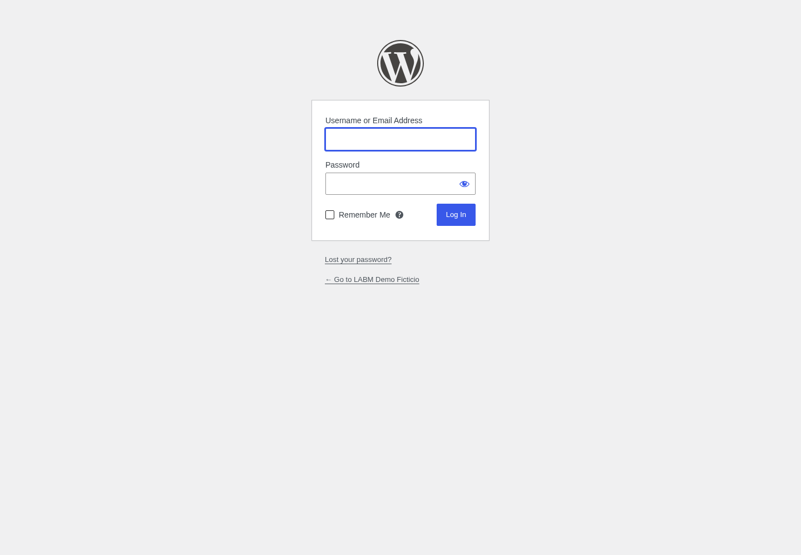

1. Abre la dirección de tu plataforma seguida de `/wp-admin/`.
2. La dirección del administrador es `https://balonmanoantioquia.com/wp-admin/`.
3. Escribe tu usuario o correo en **Username or Email Address / Nombre de usuario o correo electrónico**.
4. Escribe tu contraseña en **Password / Contraseña**.
5. Pulsa **Log In / Acceder**.
6. Comprueba que aparezca **Dashboard / Escritorio** y el menú lateral.

Si olvidaste tu contraseña, usa **Lost your password? / ¿Has olvidado tu contraseña?**. Si no recibes el correo, pide ayuda al administrador. No compartas una cuenta entre varias personas.

En el proyecto local, el responsable técnico dispone de la configuración en `.env`. Ese archivo no forma parte de las instrucciones ni de los adjuntos que se entregan a los editores; solicita tu cuenta de trabajo por el canal acordado.

## 2. Encontrar la sección correcta

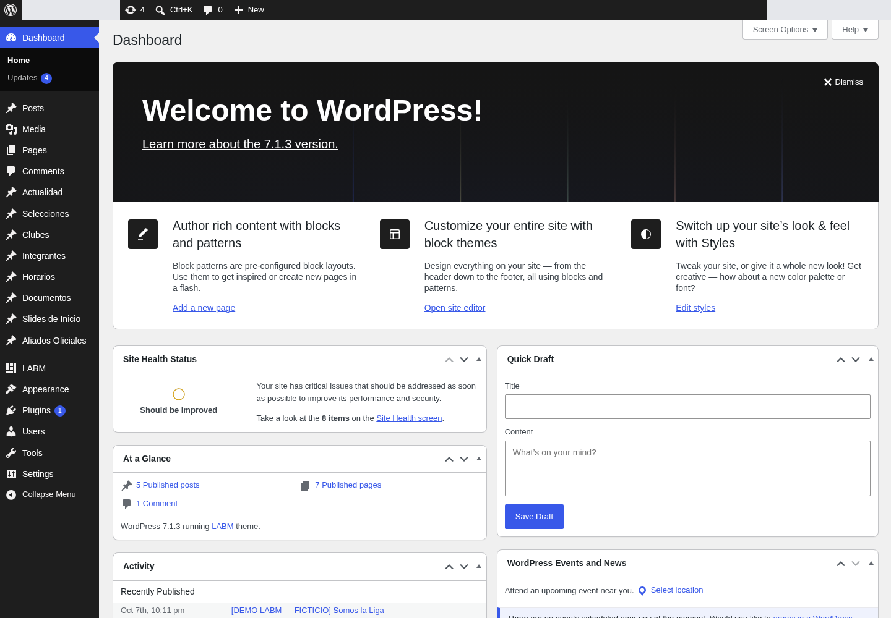

El menú público y el menú del administrador tienen funciones distintas. Para publicar contenido, usa el menú del administrador.

| Qué quieres actualizar | Menú del administrador | Dónde se refleja |
| --- | --- | --- |
| Una noticia o un evento | **Actualidad** | Actualidad y selecciones automáticas de contenido en Inicio |
| Una participación, convocatoria o logro de Piso/Playa | **Selecciones** | Listado de la modalidad y detalle individual |
| Un archivo público PDF | **Documentos** | Catálogo público de Documentos |
| Una diapositiva de portada | **Slides de Inicio** | Carrusel de Inicio |
| Un logo de aliado | **Aliados Oficiales** | Franja de aliados de Inicio |
| Un club asociado | **Clubes** | Sección de clubes de Inicio |
| Una persona de la Liga | **Integrantes** | Equipo de Nosotros, según su grupo |
| Banner de Nosotros, Misión, Visión o banner de Documentos | **Posts / Entradas** | Bloques institucionales conectados por identificador |
| Datos y enlaces del pie de página | **LABM** | Footer; correo y redes compartidos con Contacto |
| Archivos e imágenes | **Media / Medios** | Biblioteca usada por las publicaciones |
| Contenedores institucionales | **Pages / Páginas** | Páginas estructurales del sitio |

**Horarios fue retirado del administrador y del sitio el 25 de octubre de 2026.** Ya no se pueden crear ni editar horarios; sus registros locales fueron eliminados.

## 3. Crear, revisar, publicar y actualizar

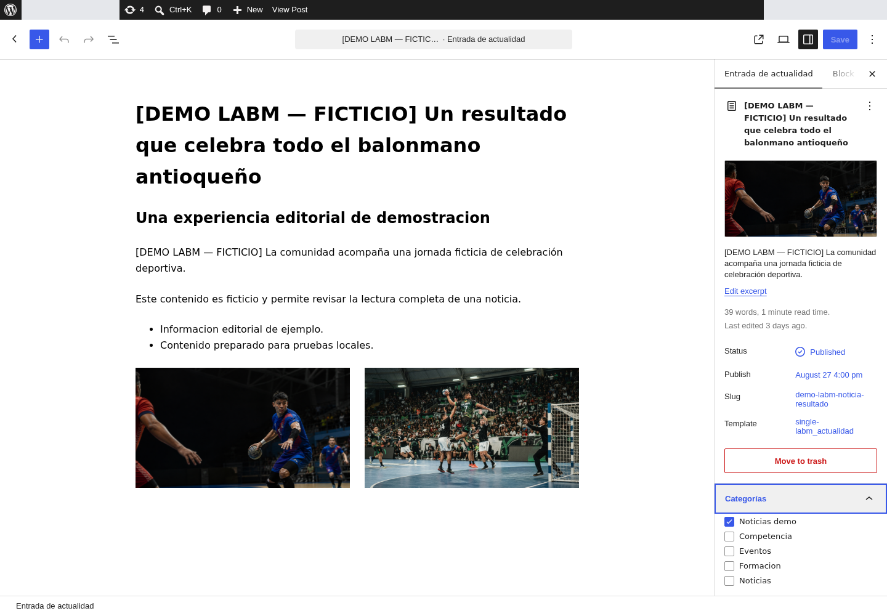

### Activar los campos personalizados

Algunas secciones usan datos adicionales que WordPress guarda como **campos personalizados**. El panel está oculto por defecto y cada usuario editor debe activarlo una sola vez:

1. Abre cualquier publicación nueva o existente en el editor de bloques.
2. Pulsa los tres puntos **⋮** de la esquina superior derecha.
3. Entra en **Preferences / Preferencias** y abre **Panels / Paneles**.
4. Activa **Custom fields / Campos personalizados**.
5. Si WordPress solicita recargar el editor, confirma la recarga.
6. Desplázate hasta el panel **Custom fields / Campos personalizados**. Para crear un campo, escribe la clave en **Name**, el dato en **Value** y pulsa **Add Custom Field**. Si la clave ya existe, modifica **Value** y pulsa **Update**.
7. Guarda o actualiza la publicación y comprueba el resultado en el sitio público cuando corresponda.

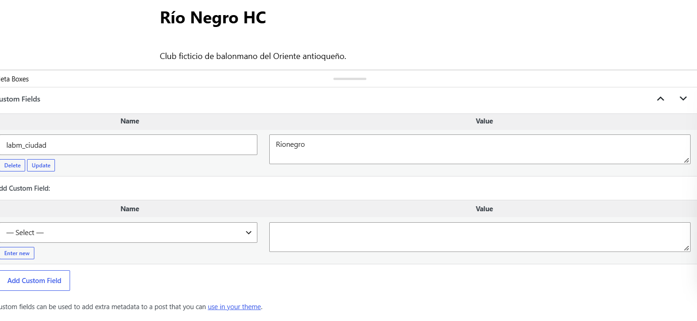

La preferencia se guarda por usuario, no por publicación. La captura anterior muestra el panel real después de activarlo; no representa el menú **Preferences / Preferencias** usado para habilitarlo. La posición y el idioma pueden cambiar según la versión de WordPress. No cambies la clave técnica ni uses espacios adicionales.

### Crear una publicación

1. Abre el menú de la sección correcta.
2. Pulsa **Añadir… / Add Post** en esa sección.
3. Escribe un título claro. Evita copiar el prefijo de demostración `[DEMO LABM - FICTICIO]` de las capturas.
4. Escribe el contenido en el editor de bloques. Usa el botón **+** para insertar párrafos, encabezados, listas, imágenes o galerías.
5. Abre la pestaña de la publicación, no solamente **Block / Bloque**, en el panel derecho.
6. Completa imagen destacada, extracto y clasificaciones según la sección.
7. Guarda como **Draft / Borrador** mientras revisas la información. Si necesitas revisión de otra persona, sigue el proceso editorial acordado antes de publicar.
8. Usa **Preview / Vista previa** cuando esté disponible. Comprueba el texto, las imágenes, los enlaces y la visualización móvil.
9. Pulsa **Publish / Publicar** y confirma en el panel de publicación.
10. Abre la página pública correspondiente y verifica el resultado.

### Editar una publicación existente

1. Busca el título en el listado de su sección.
2. Abre el título o pulsa **Edit / Editar** bajo la fila.
3. Realiza los cambios.
4. Pulsa **Save / Guardar**, **Update / Actualizar** o la acción equivalente del editor que muestre tu instalación.
5. Abre la página pública y comprueba los cambios guardados.

**Guardar no siempre significa publicar.** Revisa **Status / Estado**: una publicación en borrador o privada no aparece en los listados públicos de LABM. La fecha de publicación influye en el orden de Actualidad y Selecciones; no la cambies sólo para corregir una frase.

## 4. Actualidad: noticias y eventos

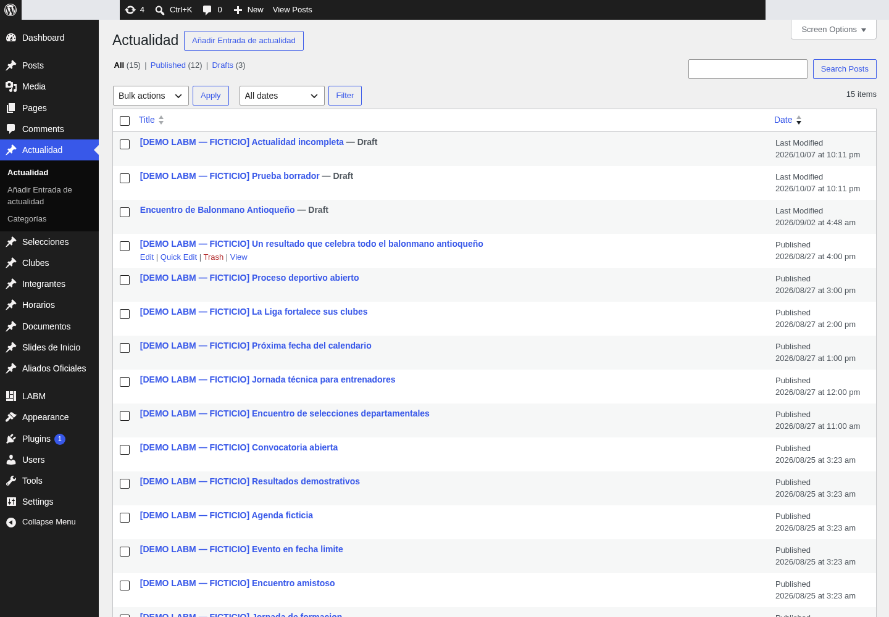

1. Entra en **Actualidad > Añadir Entrada de actualidad**.
2. Escribe el título de la noticia o del evento.
3. En el cuerpo, explica qué ocurrió o qué se realizará. Incluye fecha, lugar, participantes y detalles relevantes en texto comprensible.
4. Usa encabezados para dividir textos largos. Agrega una galería con bloques si hay varias fotografías.
5. En **Categorías**, asigna las categorías correspondientes. Abre ese apartado si está plegado.
6. En **Set featured image / Establecer imagen destacada**, elige una fotografía representativa.
7. Añade un extracto breve en **Add an excerpt… / Añadir un extracto…**. Este resumen se reutiliza en tarjetas.
8. Guarda el borrador, revisa y publica.
9. Abre **Actualidad** en el sitio público (`/actualidad/`), busca tu noticia y pulsa su título. Comprueba título, imagen, contenido, fecha y enlaces para compartir en la página individual.

La portada consulta las publicaciones de Actualidad automáticamente. La publicación destacada del bloque de noticias depende de su orden editorial; no existe en el código actual un interruptor general de “destacar esta noticia”.

Para el evento destacado de Inicio existe el dato adicional `labm_fecha_evento`, con fecha en formato `AAAA-MM-DD`. Si no ves el panel, sigue los pasos de **Activar los campos personalizados** en la sección 3. No confundas la fecha del evento con **Publish / Fecha de publicación**.

En el listado y el detalle de Actualidad, una fecha válida en `labm_fecha_evento` tiene prioridad. Si falta o es inválida, se muestra la fecha de publicación. Para que el evento destacado de Inicio use la fecha indicada, completa ese mismo dato en formato válido `AAAA-MM-DD`. El metadato `labm_demo_image` es técnico y sólo se usa en contenidos de demostración: permite seleccionar una de las imágenes de respaldo permitidas cuando una noticia no tiene imagen destacada. No lo uses para registrar fechas. El campo `lamb_demo_fecha` no existe; para la fecha del evento utiliza `labm_fecha_evento`.

## 5. Selecciones: Piso y Playa

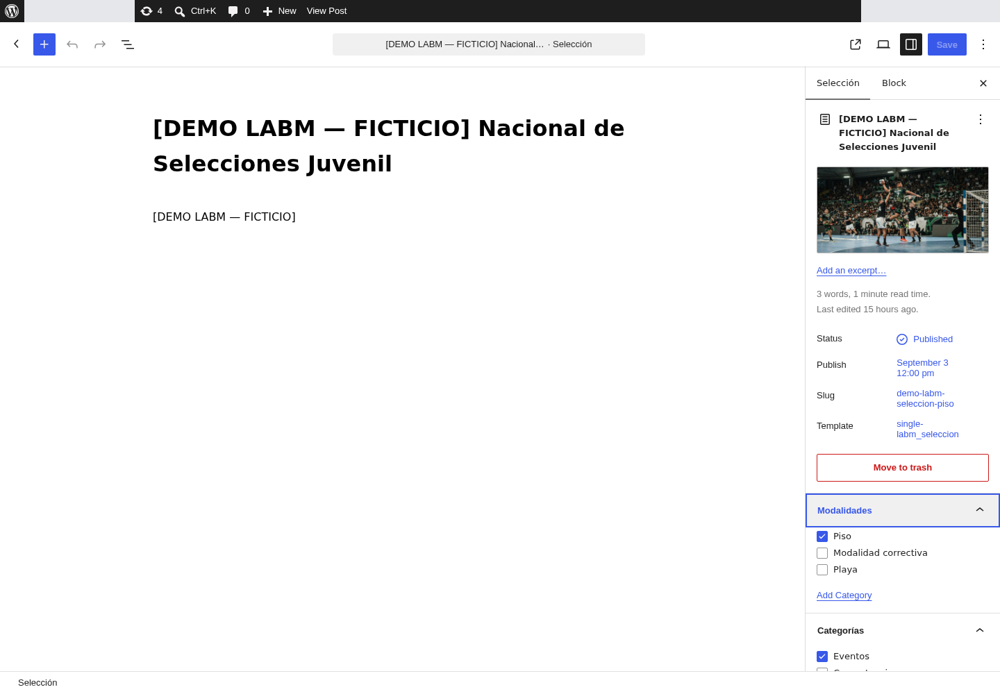

### Publicar una participación o registro

1. Entra en **Selecciones > Añadir Selección**.
2. Escribe el nombre de la participación, torneo, convocatoria o logro.
3. Describe el proceso en el cuerpo. Incluye categoría deportiva, ciudad, año, resultados y contexto cuando corresponda.
4. Abre **Modalidades** en el panel derecho y selecciona **Piso** o **Playa**. Para una publicación que pertenece a una sola modalidad, asigna solamente esa modalidad.
5. Completa **Categorías** con el tipo de publicación correspondiente.
6. Establece una imagen destacada y agrega una galería al cuerpo si necesitas varias fotos.
7. Escribe un extracto que permita entender el contenido antes de abrirlo.
8. Revisa y publica.
9. En el menú público abre **Selecciones > Balonmano Piso** o **Balonmano Playa** y comprueba que el registro aparezca en el listado adecuado.
10. Abre la interna: deben mantenerse resaltados el padre **Selecciones** y la modalidad del artículo.

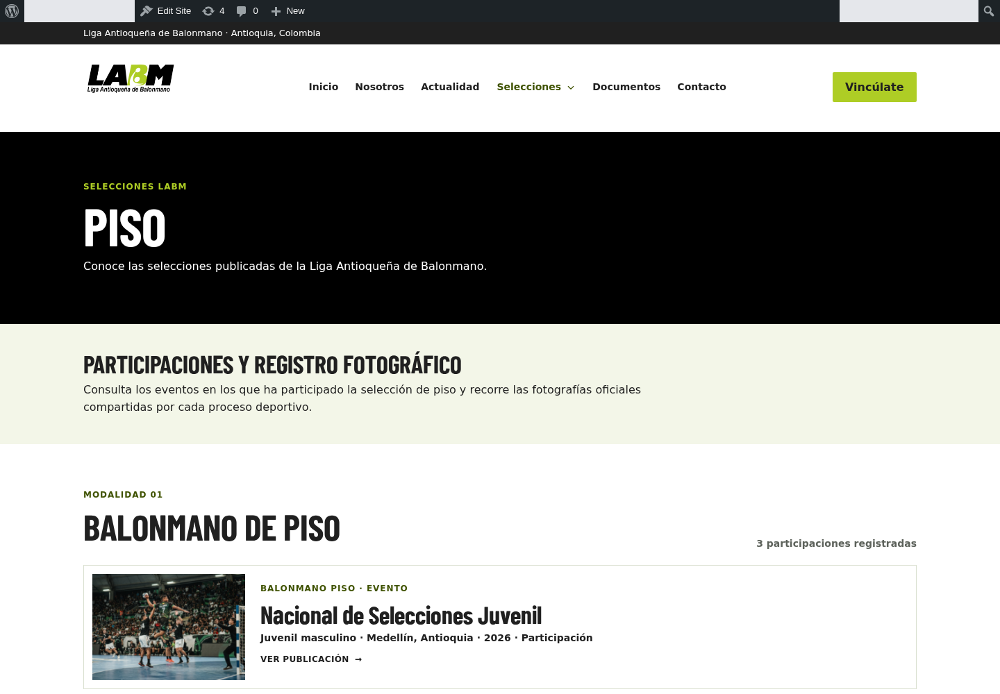

**Modalidad** y **Categorías** no son intercambiables. La modalidad determina el listado Piso/Playa y el estado activo del menú. El campo adicional `labm_modalidad_detalle` permite un texto breve de contexto de la tarjeta; no sustituye la clasificación **Modalidades**. Si no está visible, activa el panel siguiendo la sección **Activar los campos personalizados**.

El padre **Selecciones** abre el submenú por hover o clic; no lleva a una página. En móvil primero abre el menú general y luego Selecciones. Los enlaces de las modalidades sí navegan a sus listados.

Para cambiar el nombre o el texto introductorio del listado, abre **Selecciones > Modalidades** y edita la modalidad correspondiente. **Nombre** controla Piso/Playa y **Description / Descripción** controla el texto bajo la cabecera. Si la descripción está vacía, se muestra «Conoce las selecciones publicadas de la Liga Antioqueña de Balonmano». El prefijo «SELECCIÓN ANTIOQUIA ·», el título «Balonmano de Piso/Playa» y el conteo se presentan automáticamente. El título de cada publicación se cambia en su propio campo **Título**; `labm_modalidad_detalle` es opcional y se omite si está vacío.

Para Actualidad y Selecciones, la cartilla recomienda una imagen destacada horizontal de 1600 × 900 píxeles, JPG/WebP y hasta 500 KB. Las tarjetas pueden recortarla; la página individual muestra la imagen completa. En las galerías de Actualidad se recomiendan 1200 × 900 píxeles. Son recomendaciones: el máximo real se consulta en Medios.

## 6. Documentos: publicar y sustituir PDF

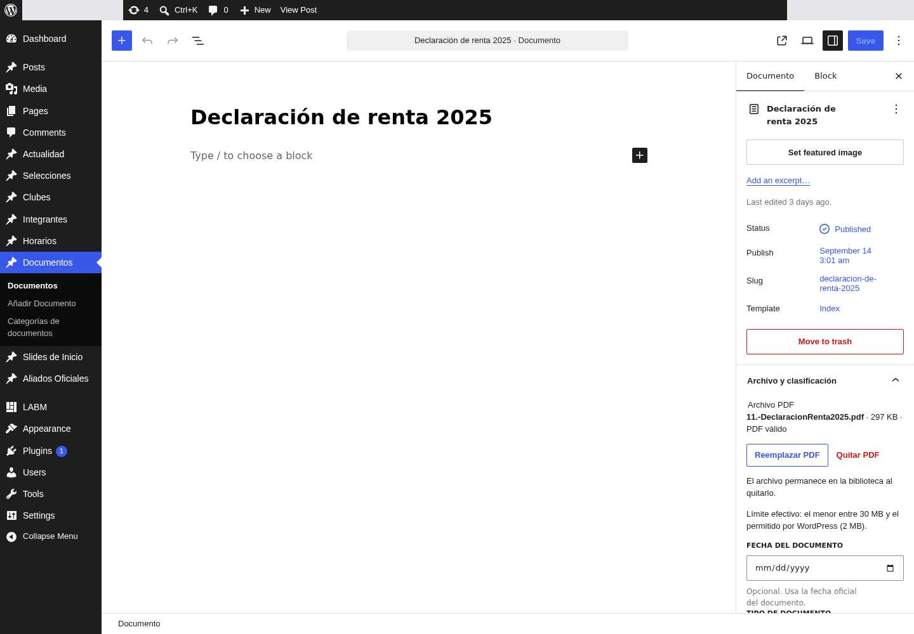

### Publicar un documento

1. Entra en **Documentos > Añadir Documento**.
2. Escribe un título que identifique el archivo, por ejemplo su nombre institucional y año.
3. En el panel derecho abre **Archivo y clasificación**.
4. Pulsa **Seleccionar o subir PDF**.
5. Elige un PDF de la biblioteca o súbelo desde tu equipo. Confirma la selección en el selector de medios.
6. Comprueba el nombre, tamaño y estado del archivo asociado.
7. Si corresponde, completa **Fecha del documento** con su fecha oficial. Este campo es opcional.
8. Selecciona un solo **Tipo de documento**. El vocabulario inicial incluye Documento general, Acta, Certificado, Circular, Resolución, Reglamento, Informe, Convocatoria y Otro; el administrador puede gestionar los tipos disponibles.
9. Publica y confirma.
10. Abre **Documentos** en el sitio público. Busca el título y comprueba las acciones **Ver PDF** y **Descargar**.

El límite efectivo es el menor entre **30 MB** y el límite permitido por WordPress. En el entorno de las capturas el panel indica **2 MB**. Mira siempre el límite que muestra tu instalación; no supongas que acepta 30 MB.

El PDF debe existir en la biblioteca, ser accesible para tu cuenta y ser un PDF válido. Cambiar la extensión de un archivo no lo convierte en PDF. No hace falta una imagen destacada para asociar el documento: utiliza el panel **Archivo y clasificación**.

### Reemplazar un PDF

1. Abre el documento existente.
2. Pulsa **Reemplazar PDF**.
3. Selecciona el nuevo archivo y comprueba sus datos.
4. Actualiza título, fecha y tipo si corresponde.
5. Guarda la publicación.
6. Comprueba **Ver PDF** y **Descargar** desde el sitio público.

**Quitar PDF** sólo desvincula el archivo de la publicación; el archivo permanece en la biblioteca. Una publicación sin PDF válido puede ser bloqueada o retirada del estado publicable por la validación. Para dejar de mostrar un documento usa un borrador o la papelera, no elimines primero su archivo de Medios.

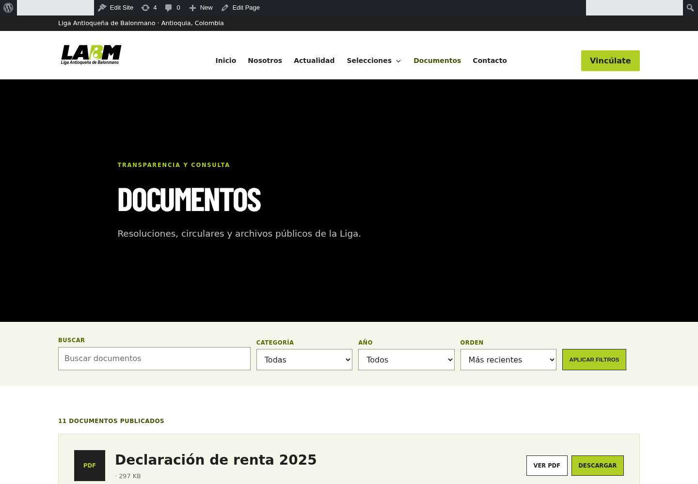

## 7. Inicio: slides

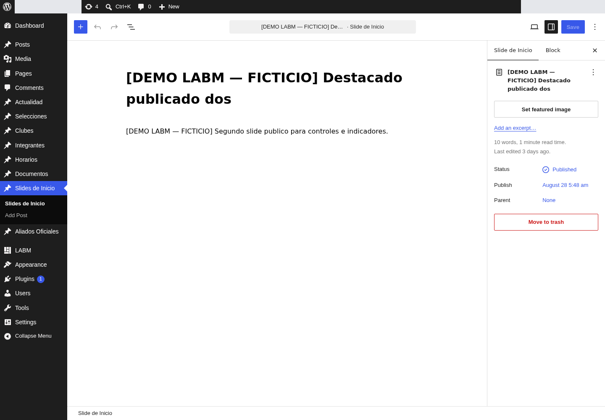

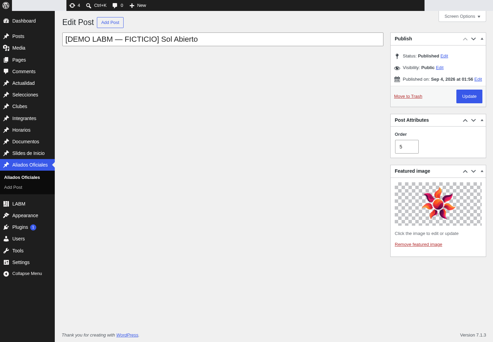

1. Abre **Slides de Inicio**.
2. Pulsa **Add Post / Añadir** o edita una diapositiva existente.
3. Escribe el título que se mostrará en el carrusel.
4. Añade el texto breve al contenido o al extracto según el texto editorial existente.
5. Asigna una **imagen destacada**. Es obligatoria para publicar, pero puedes guardar un borrador sin imagen. Si intentas publicar sin ella, el panel muestra un aviso y conserva el contenido como borrador.
6. Revisa el enlace de destino y el texto del botón si la diapositiva debe tener una llamada a la acción.
7. Publica o guarda los cambios.
8. Abre Inicio y recorre el carrusel hasta esa diapositiva. Comprueba que el texto sea legible y el botón lleve al destino correcto.

El destino del botón se guarda en `labm_destino_url` y su etiqueta en `labm_cta_texto`. Son campos personalizados, no campos del panel de Documentos. Si no aparecen en tu editor, activa el panel siguiendo la sección **Activar los campos personalizados**. Sin destino, la diapositiva no muestra ese enlace.

Completa ambos datos para que el botón tenga el destino y el texto previstos. Si hay destino y falta el texto, aparece «Conocer más»; si falta el destino, no se muestra el enlace. Después de publicar, prueba la diapositiva directamente en **Inicio**.

En la portada solo aparecen las diapositivas publicadas que tienen una imagen destacada válida. Las diapositivas sin imagen pueden conservarse como borradores; al intentar publicarlas, el panel avisa y mantiene el contenido como borrador.

Las diapositivas publicadas se ordenan por orden editorial y luego por título. El tipo admite atributos de página; según la versión del editor el orden puede aparecer en **Post Attributes / Atributos** o en **Quick Edit / Edición rápida** del listado. Si el control no está disponible para tu cuenta, solicita el orden al administrador. No alteres fechas para ordenar el carrusel.

En **Post Attributes / Atributos**, escribe un número de orden: un número menor aparece antes. Si dos slides tienen el mismo número, el título define el desempate en orden alfabético. Usa números distintos cuando necesites controlar la posición de forma predecible. La captura anterior muestra el panel estándar compartido por Slides y Aliados; en Slides el control aparece en la misma ubicación.

Las diapositivas no tienen una página pública individual. Se verifican en Inicio.

El texto breve usa primero el **Extracto** y, si está vacío, el contenido. Si ambos están vacíos, no aparece un texto de reemplazo. La cartilla recomienda una imagen horizontal de 1920 × 1080 píxeles, JPG/WebP y hasta 700 KB; deja lo importante en el centro porque la imagen se recorta según la pantalla. El límite real de carga se consulta en Medios.

## 8. Inicio: aliados y clubes

### Aliados Oficiales

**Qué vas a actualizar:** los logos que aparecen en la franja **Aliados Oficiales** de Inicio. Cada aliado necesita nombre y logo. No dispone de descripción ni de enlace externo editable.

**Antes de empezar:** ten el nombre aprobado y el logo oficial. Recomendación: PNG con fondo transparente, en un espacio horizontal de 1200 × 600 píxeles, hasta 200 KB. Deja margen alrededor del símbolo y no lo estires. Son recomendaciones, no límites de carga; consulta el máximo que aparece en Medios.

#### Crear un aliado

1. En el menú izquierdo abre **Aliados Oficiales > Add Post / Añadir**.
2. Escribe únicamente el nombre del aliado en el campo de título. No copies el prefijo de demostración de la captura.
3. En la columna derecha busca **Featured image / Imagen destacada**. Pulsa **Set featured image / Establecer imagen destacada**; si ya hay un logo, pulsa sobre él para reemplazarlo.
4. Selecciona el logo existente o usa **Upload files / Subir archivos**. En **Alternative Text / Texto alternativo**, identifica la organización; por ejemplo, «Logo de Aliado Ejemplo». Confirma la imagen seleccionada.
5. En **Post Attributes > Order / Atributos > Orden**, escribe el orden acordado. Por ejemplo, 10 aparece antes que 20. Si dos aliados tienen el mismo número, se ordenan por nombre.
6. Revisa el nombre y el logo. Pulsa **Publish / Publicar**. Si estás revisando, guarda como borrador; un borrador no se muestra al visitante.
7. Abre el sitio público, entra en **Inicio** y baja hasta **Aliados Oficiales**. Comprueba que el logo se vea completo, sin deformarse y en el orden esperado. Revisa también desde un teléfono.

#### Modificar o retirar un aliado

1. Abre **Aliados Oficiales**, localiza el nombre y pulsa **Edit / Editar**.
2. Cambia nombre, imagen u orden. Para reemplazar el logo, pulsa la imagen actual y selecciona la nueva; no borres el archivo anterior desde Medios.
3. Pulsa **Update / Actualizar** y vuelve a comprobar Inicio.
4. Para retirarlo temporalmente, cambia **Status / Estado** a **Draft / Borrador** y guarda. Para recuperarlo, revisa los datos y vuelve a publicar. Consulta la sección 12 si necesitas usar la papelera.

**Si no ves Orden:** busca **Quick Edit / Edición rápida** bajo el nombre en el listado. Si tampoco aparece, solicita el cambio al administrador.

**Si no aparece el logo:** comprueba nombre, imagen destacada y estado publicado. La franja admite hasta 12 aliados completos; se eligen por orden y luego por nombre. Si hay más, coordina el orden con el administrador. No cambies la fecha para ordenarlos.

El encabezado «Aliados Oficiales» es fijo. Para cambiarlo, solicita apoyo al administrador. Un aliado no tiene una página pública individual: se comprueba en Inicio.

### Clubes

**Qué vas a actualizar:** el nombre, logo y resumen de un club asociado, y el contenido de su página individual. Clubes y Aliados Oficiales son secciones distintas.

**Antes de empezar:** prepara el nombre oficial, una descripción, un resumen de una o dos frases y el logo. Recomendación: PNG transparente de 1000 × 1000 píxeles y hasta 200 KB, con margen alrededor. El logo se muestra completo, sin recorte. Consulta en Medios el máximo de carga permitido.

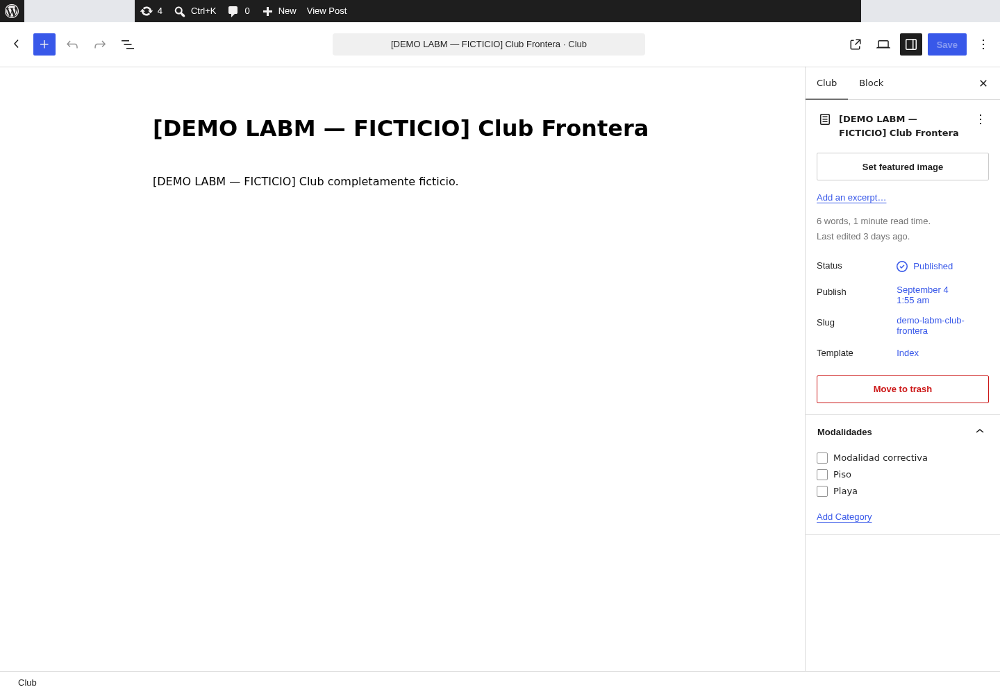

#### Publicar un club

1. Entra en **Clubes > Añadir Club**.
2. Escribe el nombre en **Título** y la descripción en el cuerpo de la publicación.
3. En el panel derecho, abre la pestaña **Club**, no **Block / Bloque**.
4. Pulsa **Set featured image / Establecer imagen destacada**, selecciona o sube el logo y confirma. Completa su texto alternativo con el nombre del club.
5. Pulsa **Add an excerpt / Añadir un extracto** y escribe el resumen breve. Ejemplo ficticio: «Club Ejemplo promueve el balonmano de piso para jóvenes del municipio». Este es el texto de la tarjeta de Inicio; si lo dejas vacío, se genera desde la descripción.
6. Abre **Modalidades** y marca Piso o Playa según corresponda al club. Usa las opciones existentes; no crees otra para corregir un nombre.
7. Guarda como borrador, revisa los datos y pulsa **Publish / Publicar** cuando estén aprobados. Confirma si WordPress lo solicita.
8. Abre **Inicio > Clubes asociados**. Si aparece el club, comprueba nombre, logo y resumen; pulsa su nombre o logo y revisa la página individual.

#### Modificar y comprobar

1. Abre **Clubes**, busca el nombre y pulsa **Edit / Editar**.
2. Cambia los datos necesarios. Si corriges la descripción, revisa también **Extracto**, porque el resumen escrito allí tiene prioridad en Inicio.
3. Pulsa **Save / Guardar** o **Update / Actualizar**, según tu editor.
4. Revisa Inicio y la página individual. Si no está en Inicio, usa **View / Ver** desde el listado o el editor para comprobar su página publicada.

**Si no aparece en Inicio:** comprueba que esté publicado. Inicio muestra hasta seis clubes, ordenados por **Orden** de menor a mayor y después por nombre. Estar publicado no garantiza entrar en esos seis. Si necesitas cambiar el orden y no encuentras el control, solicita ayuda al administrador; no cambies fechas ni dupliques el club.

**Ciudad, solo si la necesitas como referencia interna:** `labm_ciudad` es opcional y actualmente no aparece en la ficha pública. No es necesario completarlo para seguir esta guía. Si debes registrarlo, activa Campos personalizados según la sección 3, selecciona o escribe exactamente `labm_ciudad` en **Name / Nombre**, escribe la ciudad en **Value / Valor**, pulsa **Add Custom Field / Añadir campo personalizado** —o **Update / Actualizar** si existe— y guarda la publicación.

Para retirar el club, guárdalo como borrador y comprueba el resultado público; consulta la sección 12. El encabezado «Clubes asociados» requiere apoyo del administrador para cambiarse.

## 9. Nosotros: presentación, misión, visión e integrantes

### Textos institucionales

**Qué vas a actualizar:** la presentación de Nosotros, Misión y Visión. Estos textos se cambian en **Posts / Entradas**. Editar **Pages / Páginas > Nosotros** no cambia estos bloques.

**Antes de empezar:** ten el texto institucional aprobado. Para cambiar la foto principal, prepara una imagen horizontal de 1600 × 900 píxeles, JPG/WebP y hasta 500 KB como recomendación. Se recorta según la pantalla: deja el motivo principal centrado. Consulta el límite real en Medios.

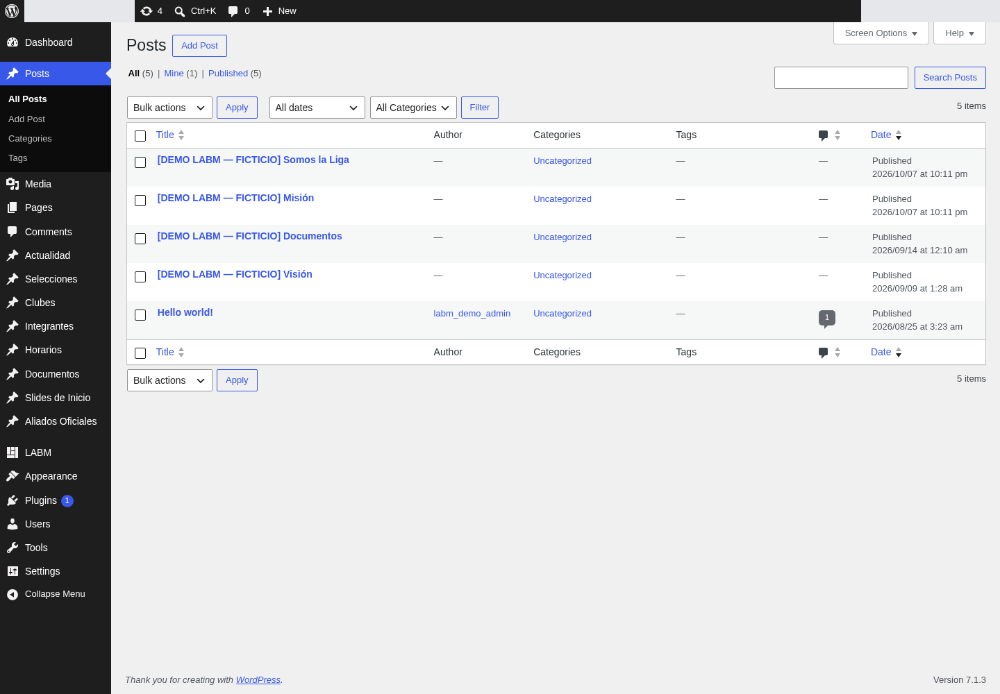

#### Localizar el texto correcto

1. Entra en **Posts / Entradas**. Busca «Misión», «Visión» o el título de la presentación, por ejemplo «Somos la Liga». Los títulos pueden haber cambiado; en la captura tienen un prefijo de demostración que no debes copiar.
2. Abre la entrada candidata. En el panel derecho selecciona **Post / Entrada**, no **Block / Bloque**, y busca **Slug / Identificador**.
3. Comprueba el valor en esta tabla. Es el nombre interno que conecta la entrada con su bloque público: léelo, pero no lo cambies.

| Texto que quieres cambiar | Identificador que debes encontrar | Dónde comprobarlo |
| --- | --- | --- |
| Presentación principal de Nosotros | `banner-nosotros` | Inicio de la página Nosotros |
| Misión | `mision-nosotros` | Bloque Misión de Nosotros |
| Visión | `vision-nosotros` | Bloque Visión de Nosotros |
| Encabezado del catálogo de Documentos | `banner-documentos` | Página Documentos; se incluye como referencia compartida |

Si no encuentras la entrada o el identificador, pide ayuda al administrador. No crees un duplicado ni cambies el identificador de otra entrada.

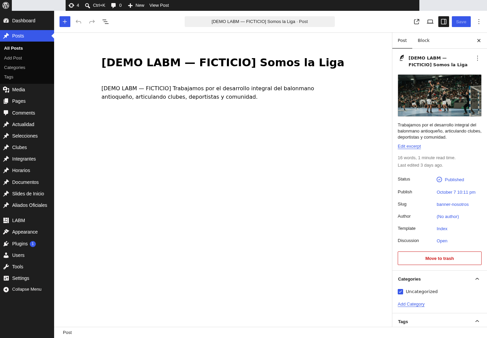

#### Cambiar la presentación de Nosotros

1. Abre la entrada con identificador `banner-nosotros`.
2. Cambia el **Título** para modificar el encabezado visible.
3. En el panel derecho abre **Edit excerpt / Editar extracto**, o **Add an excerpt / Añadir un extracto** si está vacío. Escribe el texto breve aprobado que debe verse en Nosotros.
4. Revisa también el contenido del editor. Si hay extracto, el sitio muestra ese resumen; si está vacío, muestra el contenido. Ejemplo: si el extracto dice «Versión anterior», cambiar solo el cuerpo por «Versión nueva» no cambia el texto visible. Actualiza también el extracto.
5. Si corresponde, pulsa la imagen destacada y selecciona la nueva fotografía. Conserva el identificador y el estado publicado.
6. Pulsa **Save / Guardar** o **Update / Actualizar**. Abre **Nosotros** en el sitio público y comprueba encabezado, texto y foto en computador y teléfono.

#### Cambiar Misión o Visión

1. En **Posts / Entradas**, abre la entrada con identificador `mision-nosotros` o `vision-nosotros`, según el texto que vas a cambiar.
2. Revisa el **Título** y escribe el texto aprobado en **Extracto**. Si existe contenido anterior, revísalo también para que ambos no se contradigan.
3. Conserva el identificador y el estado publicado. Guarda o actualiza.
4. Abre **Nosotros** y baja hasta **Misión** o **Visión**. Comprueba el bloque que editaste y que el otro conserve su información.

Misión y Visión no tienen una imagen pública editable en esta versión. No necesitas subir una imagen para modificar esos textos.

**Si el texto no cambia:** confirma que guardaste la entrada correcta y revisa el extracto. Recarga la página pública. Si falta el bloque completo, revisa título, texto y estado publicado. Si continúa el problema, informa al administrador qué bloque editaste y adjunta el mensaje o una captura, sin contraseñas. No vacíes ni envíes estas entradas a la papelera para ocultarlas sin coordinarlo: puede desaparecer el bloque.

### Integrantes

**Qué vas a actualizar:** las personas de la sección **Quiénes hacen posible la Liga** en Nosotros, con nombre, foto, cargo y grupo.

**Antes de empezar:** confirma el nombre completo, el cargo y el grupo: Comité, Entrenadores o Representantes. Ten una fotografía autorizada. Recomendación: JPG/WebP de 1200 × 1400 píxeles, hasta 350 KB, con el rostro centrado y espacio sobre la cabeza. La tarjeta recorta la fotografía; comprueba el resultado en el sitio. Consulta el límite de carga en Medios.

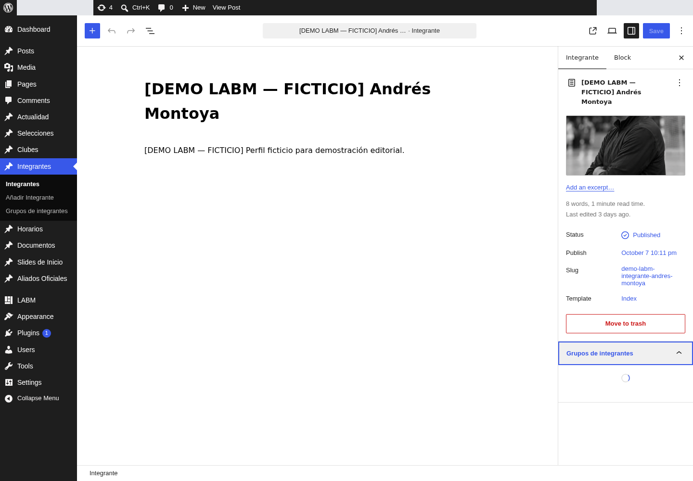

#### Crear un integrante

1. Entra en **Integrantes > Añadir Integrante**.
2. Escribe el nombre completo en **Título**. Ejemplo ficticio: «Ana Pérez». No copies el prefijo de demostración de las capturas.
3. En la pestaña **Integrante** del panel derecho, pulsa **Set featured image / Establecer imagen destacada**. Selecciona o sube la fotografía y confirma. Usa como texto alternativo una descripción breve, como «Retrato de Ana Pérez».
4. Abre **Grupos de integrantes** y selecciona un grupo existente. Para el ejemplo, elige **Entrenadores**. No crees una variante como «Equipo de entrenadores»; si necesitas otro grupo, consulta al administrador.
5. Activa **Custom fields / Campos personalizados** según la sección 3 si no lo ves. Baja al panel de campos personalizados para registrar el cargo.
6. Busca si ya existe `labm_cargo`. Si existe, cambia su **Value / Valor** por el cargo aprobado, por ejemplo «Entrenadora», y pulsa **Update / Actualizar** junto a ese campo.
7. Si no existe, en **Add Custom Field / Añadir campo personalizado** selecciona `labm_cargo` en **Name / Nombre**. Si no está en la lista, pulsa **Enter new / Introducir nuevo** y escribe exactamente `labm_cargo`. En **Value / Valor**, escribe «Entrenadora» y pulsa **Add Custom Field / Añadir campo personalizado**. No crees un segundo campo si ya está registrado.
8. Guarda la publicación como borrador mientras revisas. Cuando nombre, foto, cargo y grupo estén correctos, publica y confirma si WordPress lo solicita.
9. Abre **Nosotros**, baja hasta **Quiénes hacen posible la Liga** y comprueba la tarjeta. Pulsa **Entrenadores**: la persona debe verse en ese grupo. Revisa también **Todos** y la fotografía desde un teléfono.

La captura anterior pertenece a un club y muestra `labm_ciudad`: sirve para reconocer los controles, no para copiar ese dato. En Integrantes usa **únicamente `labm_cargo`** para el cargo. El ejemplo «Ana Pérez / Entrenadora» es una explicación, no una captura de un guardado real.

#### Modificar o retirar un integrante

1. En **Integrantes**, busca el nombre y pulsa **Edit / Editar**.
2. Cambia nombre, foto o grupo según corresponda. Para cambiar el cargo, actualiza el valor de `labm_cargo` y pulsa **Update / Actualizar** junto al campo.
3. Guarda o actualiza también la publicación. Después revisa la tarjeta y el filtro en Nosotros.
4. Para retirarlo temporalmente, cambia su estado a **Draft / Borrador** y guarda. No borres su fotografía desde Medios. Para recuperarlo, revisa sus datos y vuelve a publicar; consulta la sección 12 para la papelera.

**Si no aparece:** revisa nombre, fotografía destacada, cargo no vacío, grupo y estado publicado. Prueba el filtro **Todos**. La sección consulta hasta 20 registros publicados por orden y nombre; si hay más personas o el grupo esperado no funciona, solicita revisión al administrador. No dupliques el registro para hacerlo aparecer.

El nombre visible se cambia en **Título** y el cargo en `labm_cargo`. Los encabezados y los filtros Comité, Entrenadores y Representantes no se renombran desde el registro de una persona: pide apoyo para cambiarlos.

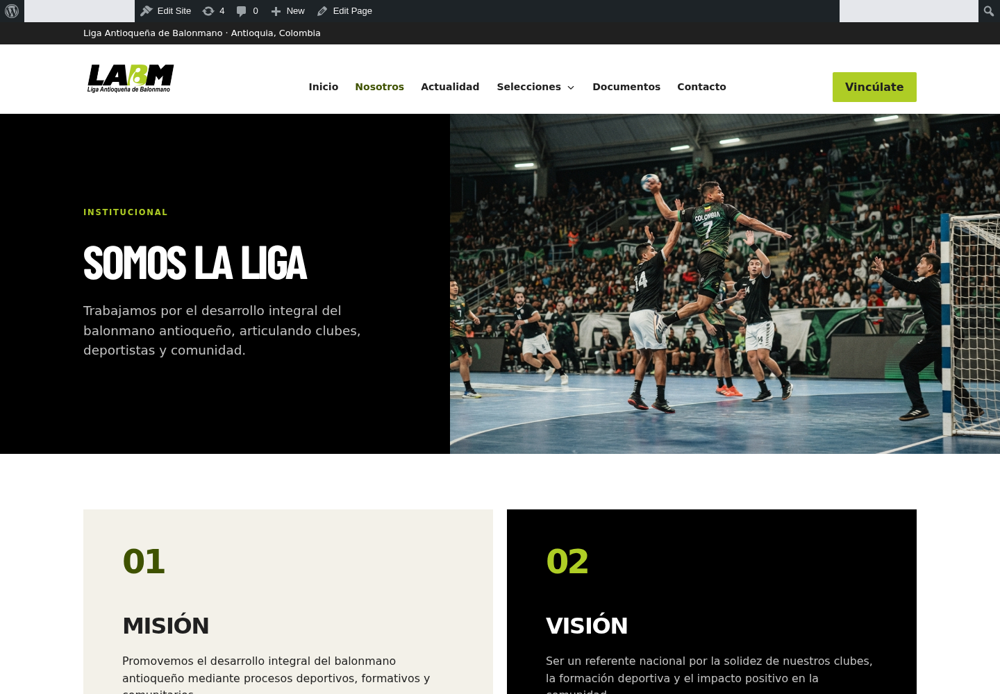

## 10. Contacto y pie de página

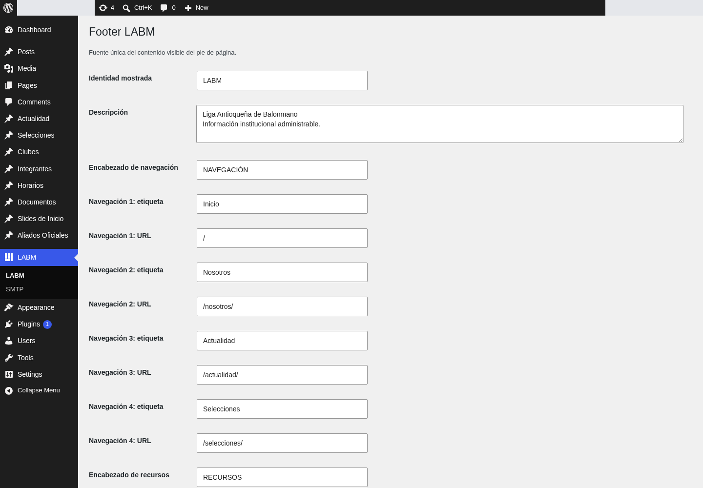

### Datos compartidos

1. Abre **LABM**, que muestra **Footer LABM**. Si no aparece, solicita acceso al administrador.
2. Revisa identidad, descripción, encabezados, etiquetas y URLs de navegación y recursos.
3. Modifica **Correo** y los campos de etiqueta/URL de Facebook e Instagram cuando corresponda.
4. Revisa la etiqueta y URL de la política de datos.
5. Baja al final y pulsa **Save Changes / Guardar cambios**.
6. Comprueba el footer en varias páginas y la sección pública Contacto.

Correo y redes se reutilizan en Contacto. Las etiquetas y URLs del footer no cambian el menú principal. El teléfono, dirección, mapa y algunos textos de Contacto están definidos en el tema/plugin actual y no tienen campos editables en esta pantalla: solicita esos cambios al responsable técnico.

### Entrega de mensajes

El formulario Contacto envía correo a los destinatarios configurados. No existe en esta implementación una bandeja editorial de mensajes dentro de WordPress. El correo visible en la página y la lista de destinatarios SMTP son configuraciones diferentes.

**LABM > SMTP** pertenece al administrador. Allí se gestionan los datos permitidos de envío y se ofrece una prueba de correo. La contraseña se administra mediante configuración técnica y no se muestra como campo editorial. Esta cartilla no contiene credenciales. No pulses **Enviar prueba** durante una simple revisión: esa acción sí envía un correo.

## 11. Biblioteca de medios y galerías

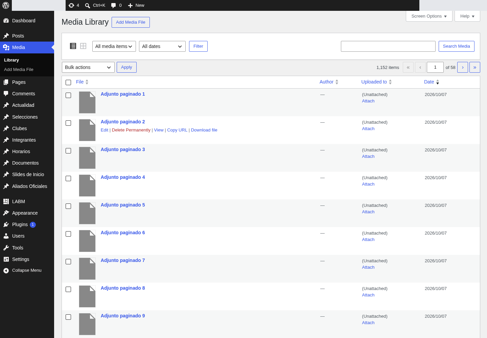

1. Entra en **Media / Medios** para buscar archivos existentes antes de subir duplicados.
2. Para una carga, usa **Add Media File / Añadir archivo** o el selector de medios de la publicación.
3. Revisa que el nombre y formato del archivo sean adecuados.
4. En una imagen, completa **Alternative Text / Texto alternativo** con una descripción útil. Para un logo, identifica a la organización.
5. En el editor, usa **Set featured image / Establecer imagen destacada** para la imagen principal.
6. Para varias fotografías, inserta el bloque **Gallery / Galería** con el botón **+** y selecciona las imágenes.
7. Ordena la galería y revisa sus pies de foto antes de publicar.

Imagen destacada y galería cumplen funciones diferentes. Una galería en el cuerpo no sustituye automáticamente la imagen destacada. No borres un archivo compartido desde Medios sin comprobar dónde se utiliza: eliminarlo puede romper otras publicaciones.

## 12. Retirar y recuperar una publicación

### Retirar sin borrar definitivamente

1. Abre la publicación.
2. Cambia **Status / Estado** a **Draft / Borrador**, si quieres conservarla para revisión, y guarda.
3. Comprueba que ya no aparezca en el listado público.

También puedes usar **Move to trash / Mover a la papelera**. No uses **Delete permanently / Borrar permanentemente** como parte de una revisión rutinaria.

### Recuperar desde la papelera

1. Abre el listado de la sección.
2. Entra en **Trash / Papelera**.
3. Localiza la publicación y usa **Restore / Restaurar**.
4. Abre el editor y revisa estado, contenido, imagen y clasificación.
5. Publica de nuevo sólo cuando hayas verificado los datos. Restaurar desde la papelera no debe asumirse como una aprobación editorial.

## 13. Resolver problemas frecuentes

| Problema | Qué comprobar |
| --- | --- |
| No aparece un menú del administrador | Rol y permisos de tu cuenta; solicita acceso al administrador. |
| Una publicación no aparece en el sitio | Estado publicado, sección correcta y filtros activos. Revisa también los límites de elementos de la portada. |
| Una selección aparece en el listado equivocado | Taxonomía **Modalidades**, no sólo el texto del título o el campo de detalle. |
| No se resalta la modalidad en la interna | Asignación Piso/Playa de esa selección; informa al administrador si está correcta y el fallo persiste. |
| Un integrante publicado no aparece | Nombre, cargo `labm_cargo`, imagen destacada y grupo compatible. |
| Un slide o aliado no se puede publicar | Título e imagen destacada o logo obligatorios. |
| Un cambio de texto institucional no se ve | Identificador de la entrada y extracto existente; el extracto tiene prioridad sobre el cuerpo. |
| No se guarda un PDF | Archivo realmente PDF, disponible, válido, bajo el límite efectivo y permitido para tu cuenta. |
| No veo los datos adicionales de una sección | Activa **Custom fields / Campos personalizados** desde **⋮ → Preferences / Preferencias → Panels / Paneles**. Si el panel sigue sin aparecer, solicita revisión al administrador. |
| El formulario Contacto falla al enviar | Reporta fecha, pantalla y mensaje al administrador SMTP; no compartas contraseñas. |
| Guardé, pero sigo viendo lo anterior | Confirma que guardaste la publicación correcta, abre su página pública y recarga. Si continúa, solicita revisión de caché al administrador. |

## 14. Lista de revisión y límites del panel

### Antes de publicar

- [ ] La publicación pertenece a la sección correcta.
- [ ] Título y texto están completos y revisados.
- [ ] No quedan textos de demostración usados como información institucional.
- [ ] Imagen destacada, logo o PDF corresponden a la publicación.
- [ ] Fotografías y archivos tienen autorización de uso.
- [ ] Las imágenes importantes tienen texto alternativo.
- [ ] La modalidad, grupo o tipo está correctamente asignado.
- [ ] El extracto resume el contenido y no contradice el cuerpo.
- [ ] Fechas y enlaces son correctos.
- [ ] Se revisó la vista previa y la visualización móvil.
- [ ] El estado final es el acordado: borrador, revisión o publicado.

### Después de publicar

- [ ] Se comprobó la sección pública correspondiente: Inicio para Aliados y Clubes; Nosotros para textos e Integrantes.
- [ ] Se abrió el detalle individual cuando exista; Aliados e Integrantes se comprueban en su sección.
- [ ] Los botones y enlaces funcionan.
- [ ] En Documentos se verificaron **Ver PDF** y **Descargar**.
- [ ] En Selecciones el padre y la modalidad permanecen activos en la interna.

### Qué requiere apoyo del administrador o del equipo técnico

El editor no necesita cambiar plantillas, código, usuarios, SMTP, plugins ni ajustes generales para publicar contenido habitual. Algunos datos adicionales actuales no cuentan con formularios dedicados, y varios textos estáticos pertenecen al tema. Esta guía distingue esos límites para evitar instrucciones de botones que la plataforma no tiene.

**Pages / Páginas** contiene las páginas estructurales, pero editar el cuerpo de una página no garantiza cambiar bloques alimentados por otras colecciones. Para Nosotros y Documentos usa las entradas institucionales de la tabla; para Inicio usa las colecciones correspondientes. Cambios de estructura, navegación principal o diseño deben coordinarse con el responsable técnico.

### Nota para el responsable técnico

Si se realizan ediciones de contenido en el entorno local y se deben compartir o entregar, sigue [la sincronización oficial de contenido](../content-sync.md). Esta operación no forma parte del flujo habitual de un editor que publica directamente en WordPress de producción. Nunca incluyas usuarios, contraseñas o datos privados de cuentas en paquetes de contenido ni en este manual.

### Fuentes de esta versión

La versión 1.5 amplía Aliados Oficiales, Clubes, Integrantes y Nosotros para personal no técnico y alinea las reglas compartidas con la cartilla. Se revisaron las capturas existentes y el código; no se guardó ni publicó contenido en WordPress durante esta actualización. La comprobación documental no certifica una prueba de guardado ni reemplaza la revisión pendiente de cada responsable.

Las instrucciones se contrastaron con las pantallas reales capturadas y con el registro de contenido de `labm-core`, el panel administrativo de Documentos y los renderizadores del tema `labm`. Las capturas se realizaron abriendo contenido existente sin publicar ni editar sus textos o archivos. Los cambios futuros de interfaz deben reflejarse en nuevas versiones del manual y sus imágenes.
